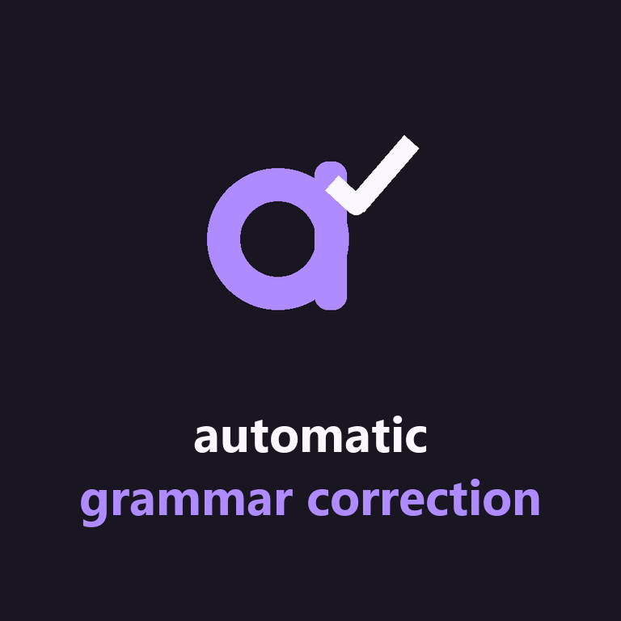

<p align="center"></p>

# automatic grammar correction

Corretor gratuito de português brasileiro para a bandeja do Windows. Em campos Win32 Edit compatíveis, ao terminar uma palavra, o aplicativo pode trocar **“voce tambem ”** por **“Você também ”** no próprio editor. O texto só é lido em memória, os recursos linguísticos acompanham o aplicativo e a correção funciona offline.

## Instalar e usar

1. Baixe o ZIP Windows x64 na [página de versões](https://github.com/TiagoEstetele/automatic-grammar-correction/releases). Extraia **toda a pasta** e abra `AutomaticGrammarCorrection.exe`. O pacote inclui o runtime necessário. Não requer administrador.
2. O ícone roxo aparece na bandeja, às vezes na seção de ícones ocultos. Dê dois cliques para abrir as configurações. O menu também permite pausar o modo automático ou sair.
3. Digite uma palavra e avance com espaço ou pontuação. O AGC revisa a palavra concluída, sem esperar que você pare de escrever a frase toda. Em campos Win32 Edit compatíveis, aplica o ajuste. No Codex e em campos de navegador com acessibilidade disponível, apresenta a sugestão acima da palavra e preserva o rascunho.
4. Para melhorar uma parte específica, selecione-a com o mouse ou com Shift e as setas. O pop-up aparece acima da seleção (abaixo se faltar espaço). Escolha **Ortografia**, **Gramática**, **Pontuação** ou **Tudo** e confira a prévia. Use **Aplicar** quando disponível ou **Copiar resultado** e **Ctrl+V**. Para a revisão completa pelo atalho, selecione texto e pressione **Ctrl+Shift+G**, ou escolha **Melhorar texto** na bandeja. Uma seleção editável tem prioridade. Sem seleção, o comando revisa o texto já copiado e deixa o resultado na área de transferência. Para trabalhar exclusivamente com o conteúdo copiado, use **Melhorar texto copiado**. A bandeja também funciona se outro aplicativo tiver reservado o atalho.

| Entrada | Resultado da revisão |
|---|---|
| `voce  tambem vem ?` | `Você também vem?` |
| `no entanto eu nao fui` | `No entanto, eu não fui.` |
| `isso me da vontade de correr` | `Isso me dá vontade de correr.` |
| `isso custa 1,50 reais` | `Isso custa 1,50 reais.` |

## Painel e revisão


Em **Visão geral**, teste uma frase e pause ou retome o corretor. Em **Aplicativos**, a busca encontra um executável por nome ou caminho. A prévia do pop-up deixa você decidir se quer aplicar ou copiar.


## Alcance das correções

O motor combina sinais lexicais de português com o dicionário VERO. O perfil automático exige indícios do idioma. URLs, e-mails, números decimais, identificadores e trechos reconhecidos como código são preservados. As heurísticas têm limites em textos mistos, nomes próprios e citações. Em **Configurações → Digitação**, cada família pode ser desativada individualmente. Durante a digitação, acentos comuns e erros conhecidos usam uma tabela local para resposta imediata. Para outras grafias, o AGC aceita uma sugestão próxima sem ambiguidade quando identifica português pelo contexto. As vírgulas se restringem ao conector “no entanto”. A busca aproximada mais ampla é opcional na revisão completa. Escolher **Ortografia** no pop-up pede essa busca explicitamente.

A revisão corrige os padrões documentados e mantém o sentido do texto. O projeto não oferece paráfrase livre nem cobertura completa da gramática. As regras de concordância tratam formas frequentes como “eles tem”, “nós vai” e “a gente vamos”. A lista de padrões adaptados e suas condições está em `Lightproof.cs`.

## Aplicativos, privacidade e tela cheia

Em **Configurações → Aplicativos**, todos os executáveis identificados com janela aberta ou já utilizados começam habilitados. A preferência usa o caminho do executável. Os dados ficam em `%LOCALAPPDATA%\AutomaticGrammarCorrection\settings.json`, com gravação por substituição atômica. O arquivo contém caminhos e preferências, nunca os textos digitados. Uma configuração inválida é copiada para `.bak` quando possível. Para desinstalar, saia pela bandeja e remova a pasta extraída. Exclua a pasta de preferências se também quiser apagar o histórico de aplicativos.

Ao entrar em tela cheia, a correção automática começa pausada. Uma notificação oferece a escolha. Também é possível responder pelo menu **Correção nesta tela cheia…** se o Windows suprimir as notificações. A decisão vale para aquela janela até ela sair de tela cheia ou fechar. Alternar tarefas mantém a decisão. Uma janela maximizada comum mantém o comportamento habitual.

**No Codex e em campos de navegador**, o AGC deixa o rascunho intacto enquanto você digita. Selecione a frase e pressione **Ctrl+Shift+G**. Quando aparecer **Texto melhorado**, o resultado estará na área de transferência. Use **Ctrl+V** para substituir a seleção quando quiser. Se o editor não oferecer acesso à seleção, use **Ctrl+C → Melhorar texto copiado** no menu da bandeja e depois **Ctrl+V**. Senhas são ignoradas.

A edição automática direta fica restrita a controles clássicos Win32 Edit fora do Codex. Neles, o AGC confere o conteúdo, a seleção e o limite de caracteres. Se o trabalho for cancelado depois que o AGC selecionou um trecho, ele restaura o cursor original somente se a seleção ainda for dele. A revisão sob demanda aceita até 100 mil caracteres. Em campos de chat, revise antes de enviar.

Ao atualizar da 1.0.0, escolha **Sair** no ícone antigo, extraia a nova versão em outra pasta e abra o novo executável. As preferências locais são compartilhadas entre as versões.

## Escolhas técnicas

**C# com .NET 10 LTS, WinForms e APIs nativas do Windows.** WinForms fornece a bandeja, o loop de mensagens e as configurações em um único processo. Raw Input sinaliza limites de palavras sem bloquear o teclado nem reconstruir as teclas digitadas. WinEvent sinaliza mudanças de foco e geometria. A enumeração de janelas ocorre ao abrir a lista de aplicativos. Os temporizadores são de disparo pontual durante trabalho pendente, sem varredura contínua em repouso. O dicionário só é carregado quando o motor recebe texto elegível. O runtime autocontido prioriza a instalação offline. [Ciclo de suporte do .NET](https://dotnet.microsoft.com/en-us/platform/support/policy) · [Raw Input no Windows](https://learn.microsoft.com/en-us/windows/win32/inputdev/about-raw-input)

**WeCantSpell.Hunspell, VERO e regras do Lightproof.** O port gerenciado lê as listas e flexões reais de pt-BR. Ele fornece ortografia; as regras locais cuidam de gramática e pontuação. Esse conjunto evita manter um servidor Java ou um modelo de linguagem residente. Os arquivos do VERO e a versão do pacote são fixados no repositório. [Dependências, autoria e licenças](licenses/THIRD-PARTY.md)

## Compilar e testar

Use Windows x64 com o SDK .NET 10. O primeiro restore de desenvolvimento precisa de acesso ao NuGet. A execução do pacote publicado é inteiramente local.

```powershell
dotnet restore tests/AGC.Tests --locked-mode
dotnet run --project tests/AGC.Tests -c Release --no-restore -- --windows
dotnet run --project src/AGC -c Release
```

Para gerar o ZIP autocontido:

```powershell
.\tools\package.ps1
```

O pacote aparece em `artifacts/`. As fontes estão em `src/AGC/`, os testes em `tests/`, o dicionário em `resources/pt_BR/` e os ícones/avatares em `assets/`. O script opcional `tools/brand.py` regenera a arte com Pillow e as fontes do Windows. Não é necessário para compilar.

O executor de testes retorna código diferente de zero em caso de falha. Ele cobre correções, idempotência, idioma, proteção de tokens, opções desligadas, sessões de tela cheia e controles Win32 reais, incluindo preservação de seleção, cancelamento e campos protegidos. Para verificar a integração na máquina de destino, digite no Bloco de Notas, em um campo do navegador e em um aplicativo desativado. Em seguida, teste F11, Alt+Tab, saída de tela cheia e o comando sobre texto copiado.

