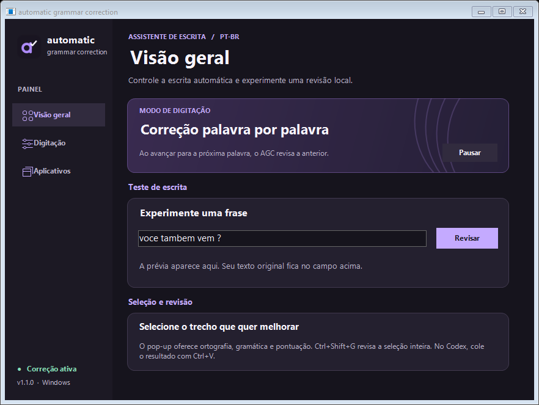
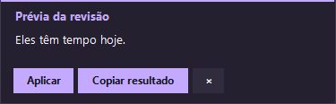
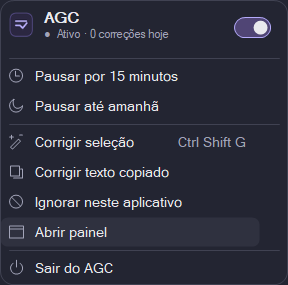

# automatic grammar correction

Corretor gratuito de português brasileiro para a bandeja do Windows. Em campos Win32 Edit compatíveis, ao terminar uma palavra, o aplicativo pode trocar **“voce tambem ”** por **“Você também ”** no próprio editor. O texto só é lido em memória, os recursos linguísticos acompanham o aplicativo e a correção funciona offline.

## Veja o AGC em ação

<a href="docs/media/agc-explainer.mp4"><picture><source media="(prefers-reduced-motion: reduce)" srcset="docs/media/agc-explainer-capa.jpg"></picture></a>

[**Vídeo completo com som e legendas · MP4 · 42,5 s**](docs/media/agc-explainer.mp4)

O Explainer original mostra a escrita de um e-mail, a correção por palavra, a revisão de uma seleção, o painel local e a pausa pela bandeja. A animação acima é a prévia silenciosa para o GitHub. Os números do filme são ilustrativos.

## Instalar e usar

1. Baixe o [instalador para Windows x64](https://github.com/TiagoEstetele/automatic-grammar-correction/releases/download/v2.0.1/AGC-Setup-2.0.1-win-x64.exe), execute-o e clique em **Instalar**. Ao concluir, abra o AGC pelo **menu Iniciar**. O assistente oferece um atalho opcional na área de trabalho. O instalador já contém o runtime, funciona offline e não pede administrador.
2. Dê dois cliques no executável ou no ícone de duas linhas da bandeja para abrir as configurações. Se a janela estiver minimizada, ela será restaurada. O corretor usa uma única instância. Para iniciar silenciosamente, execute `AutomaticGrammarCorrection.exe --tray`.
3. Espaço e pontuação disparam a revisão da última palavra. Nos campos Win32 Edit compatíveis, o AGC corrige diretamente. Em editores acessíveis como o Codex, o modo automático pode ajustar os separadores imediatamente antes do cursor: por exemplo, “no entanto ” vira “no entanto, ”. Ele nunca seleciona palavras inteiras para redigitá-las em segundo plano. Decimais como “1,50” são preservados.
4. Selecione o trecho desejado. Com o pop-up aberto, pressione **F8** para revisar tudo e substituir a seleção de uma vez. Se preferir, escolha **Ortografia**, **Gramática** ou **Pontuação** antes de pressionar F8. O botão **Revisar e aplicar** também funciona quando outro aplicativo já reservou a tecla. Fora do pop-up, F8 conserva sua função normal. **Ctrl+Shift+G** abre a prévia completa da seleção editável ou melhora o conteúdo copiado quando não há seleção. Com a prévia visível, **Enter** ou **F8** aplica, **Ctrl+C** copia e **Esc** fecha. Se uma tecla estiver em uso, os botões continuam disponíveis.

| Entrada | Resultado da revisão |
|---|---|
| `voce  tambem vem ?` | `Você também vem?` |
| `no entanto eu nao fui` | `No entanto, eu não fui.` |
| `isso me da vontade de correr` | `Isso me dá vontade de correr.` |
| `isso custa 1,50 reais` | `Isso custa 1,50 reais.` |

## Painel e revisão



Em **Visão geral**, o teste de escrita destaca as alterações enquanto você digita. Os contadores de hoje mostram revisões aplicadas, palavras verificadas e tempo médio de processamento local. Em **Digitação**, escolha as regras, o momento da revisão, som e indicador. Em **Aplicativos**, busque por nome ou executável, filtre por ativos ou ignorados e adicione um programa pelo arquivo .exe.



## Alcance das correções

O motor combina sinais lexicais de português com o dicionário VERO. O perfil automático exige indícios do idioma. URLs, e-mails, números decimais, identificadores e trechos reconhecidos como código são preservados. As heurísticas têm limites em textos mistos, nomes próprios e citações. Em **Configurações → Digitação**, cada família pode ser desativada individualmente. Durante a digitação, acentos comuns e erros conhecidos usam uma tabela local para resposta imediata. Para outras grafias, o AGC aceita uma sugestão próxima sem ambiguidade quando identifica português pelo contexto. As regras de vírgula incluem conectores como “no entanto”, “além disso”, “por outro lado” e “ou seja”. Perguntas diretas reconhecidas recebem “?” ao concluir o parágrafo ou revisar a seleção. A busca aproximada mais ampla é opcional na revisão completa. Escolher **Ortografia** no pop-up pede essa busca explicitamente.

A revisão corrige os padrões documentados e mantém o sentido do texto. O projeto não oferece paráfrase livre nem cobertura completa da gramática. As regras de concordância tratam formas frequentes como “eles tem”, “nós vai” e “a gente vamos”. A lista de padrões adaptados e suas condições está em `Lightproof.cs`.

## Aplicativos, privacidade e tela cheia

Em **Configurações → Aplicativos**, todos os executáveis identificados com janela aberta ou já utilizados começam habilitados. A preferência usa o caminho do executável. Os dados ficam em `%LOCALAPPDATA%\AutomaticGrammarCorrection\settings.json`, com gravação por substituição atômica. O arquivo contém caminhos, preferências e contadores agregados do dia, nunca os textos digitados. Uma configuração inválida é copiada para `.bak` quando possível. Para desinstalar, escolha **Sair do AGC** na bandeja e depois **Configurações do Windows → Aplicativos → Aplicativos instalados → automatic grammar correction → Desinstalar**. Exclua a pasta de preferências se também quiser apagar o histórico de aplicativos.

Ao entrar em tela cheia, a correção automática começa pausada. Uma notificação oferece a escolha. Também é possível responder pelo menu **Correção nesta tela cheia…** se o Windows suprimir as notificações. A decisão vale para aquela janela até ela sair de tela cheia ou fechar. Alternar tarefas mantém a decisão. Uma janela maximizada comum mantém o comportamento habitual.

**Aplicação no Codex e em campos de navegador.** A revisão explícita coloca o resultado na área de transferência e solicita uma única colagem sobre a seleção. Antes disso, o AGC confere a janela, o campo editável e o trecho original. A área de transferência fica com a versão revisada. Se o editor não confirmar a alteração, o AGC avisa e não repete a colagem. Campos protegidos, somente leitura ou sem uma seleção verificável não recebem essa substituição. Durante a digitação, apenas espaços e sinais junto ao cursor podem ser alterados automaticamente por acessibilidade; para as demais mudanças, use F8.

**Menu da bandeja.** Um clique abre as ações e dois cliques abrem as configurações. Pause por 15 minutos ou até amanhã, ignore o aplicativo atual ou retome pelo interruptor. **Ctrl+Alt+P** alterna a pausa quando o atalho está disponível.



Para atualizar, escolha **Sair do AGC** na bandeja e execute o novo instalador. Ele atualiza a instalação do usuário e preserva as preferências. Se você usava a antiga versão ZIP, passe a abrir o AGC pelo menu Iniciar. A pasta portátil anterior não é removida.

## Escolhas técnicas

**C# com .NET 10 LTS, WinForms, WPF e APIs nativas do Windows.** O painel Nocturne é WPF, com a fonte Inter incluída no pacote. A bandeja e a prévia usam janelas nativas, sem navegador residente. O loop de mensagens e o painel compartilham um único processo. Raw Input sinaliza limites de palavras sem bloquear o teclado nem reconstruir as teclas digitadas. WinEvent sinaliza mudanças de foco e geometria. A enumeração de janelas ocorre ao abrir a lista de aplicativos. Os temporizadores são de disparo pontual durante trabalho pendente, sem varredura contínua em repouso. O dicionário só é carregado quando o motor recebe texto elegível. O runtime autocontido prioriza a instalação offline. [Ciclo de suporte do .NET](https://dotnet.microsoft.com/en-us/platform/support/policy) · [Raw Input no Windows](https://learn.microsoft.com/en-us/windows/win32/inputdev/about-raw-input)

**WeCantSpell.Hunspell, VERO e regras do Lightproof.** O port gerenciado lê as listas e flexões reais de pt-BR. Ele fornece ortografia; as regras locais cuidam de gramática e pontuação. Esse conjunto evita manter um servidor Java ou um modelo de linguagem residente. Os arquivos do VERO e a versão do pacote são fixados no repositório. [Dependências, autoria e licenças](licenses/THIRD-PARTY.md)

## Compilar e testar

Use Windows x64 com o SDK .NET 10. O primeiro restore de desenvolvimento precisa de acesso ao NuGet. A execução do pacote publicado é inteiramente local.

```powershell
dotnet restore tests/AGC.Tests --locked-mode
dotnet run --project tests/AGC.Tests -c Release --no-restore -- --windows
dotnet run --project src/AGC -c Release
```

Para gerar o instalador offline:

```powershell
.\tools\package.ps1
```

O arquivo `AGC-Setup-<versão>-win-x64.exe` aparece em `artifacts/`. No primeiro build, o script prepara uma cópia portátil do compilador Inno Setup 6.7.4 e verifica o SHA-256. Para usar um compilador já instalado, passe `-Iscc <caminho para ISCC.exe>`. O compilador só é necessário para gerar o instalador. As fontes estão em `src/AGC/`, os testes em `tests/`, o dicionário em `resources/pt_BR/` e os ícones/avatares em `assets/`. O script opcional `tools/brand.py` regenera a arte com Pillow e as fontes do Windows. Não é necessário para compilar.

O executor de testes retorna código diferente de zero em caso de falha. Ele cobre correções, idempotência, idioma, proteção de tokens, opções desligadas, sessões de tela cheia e controles Win32 reais, incluindo preservação de seleção, cancelamento e campos protegidos. Para verificar a integração na máquina de destino, digite no Bloco de Notas, em um campo do navegador e em um aplicativo desativado. Em seguida, teste F11, Alt+Tab, saída de tela cheia e o comando sobre texto copiado.


O vídeo e a prévia animada podem ser recriados a partir do HTML Explainer original com [tools/export_explainer.py](tools/export_explainer.py). Playwright e FFmpeg são ferramentas opcionais de exportação e não acompanham o aplicativo.
